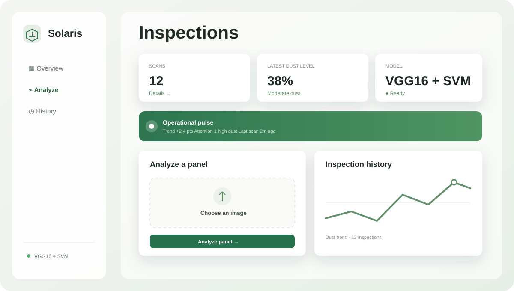

<div align="center">

# Solaris
### The quiet cost of a dusty panel is still a cost.

A focused inspection tool that turns a solar-panel image into a dust reading and a clear next step.

**Flask · VGG16 features · SVM**

</div>

---

## Interface glimpse

Solaris uses a compact inspection cockpit: upload a panel image, see the model decision, and scan the operational pulse and dust trend without leaving the page.



The interface supports light and dark themes, drag-and-drop uploads, local inspection history, condition filters, CSV export, and responsive layouts for smaller screens.

## One image. One useful answer.

Upload a panel photo. Solaris extracts visual features with VGG16, classifies them with the bundled SVM, and returns a dust estimate with practical maintenance guidance.

The interface is intentionally small: inspect, understand, act. It does not claim live sensor readings, automatic cleaner control, or site-wide analytics unless those systems are connected separately.

## How it works

```text
Panel image → validation → VGG16 features → scaled features → SVM dust estimate
```

- Accepts JPG and PNG images up to 8 MB.
- Rejects unsupported or invalid image files.
- Limits analysis requests to help protect the service.
- Removes the temporary server-side upload after processing.
- Keeps inspection history in the current browser only; it is not shared or synced.

## Start locally

Use Python 3.10 or later. Install the packages used by `app.py` in your environment: Flask, Flask-Limiter, TensorFlow, Pillow, NumPy, and Joblib. The repository also needs the compatible scikit-learn version used to create its serialized models.

```bash
python -m venv .venv
source .venv/bin/activate        # Windows: .venv\Scripts\activate
pip install Flask Flask-Limiter tensorflow pillow numpy joblib scikit-learn
python app.py
```

Open <http://127.0.0.1:5000>.

On first startup, TensorFlow may download the ImageNet VGG16 weights. The SVM classifier and scaler must be present at `Models/svm_classifier.pkl` and `Models/scaler.pkl`.

## Project map

```text
app.py                 Flask routes and image-analysis pipeline
Models/                SVM classifier and feature scaler
 templates/index.html  Inspection interface
static/css/            Application styles
static/js/             Upload, results, theme, and history behavior
```

## Important limits

- This is an image-based prototype, not a complete IoT deployment. The README describes BH1750 sensors, ESP32 control, and cleaning hardware, but those integrations are not implemented in the Flask app.
- The displayed dust score is the model output; it is not a calibrated measurement of lost energy, cleaning savings, or panel efficiency.
- Inspection history is browser-local. There are no user accounts, shared workspaces, database, or cross-device records.
- `joblib` model files should only be loaded from trusted sources. Keep production secrets out of source control and run the Flask application behind a production WSGI server rather than Flask's development server.

## Model and project

The project explores a hybrid computer-vision pipeline for identifying dust on solar panels. Model quality and operational claims should be validated against representative field data before using results for maintenance or commercial decisions.
